# Manual de usuario — Visor WSI con análisis de tejido e IA

Este manual explica, pantalla a pantalla, qué se puede hacer en la aplicación y
cómo hacerlo. Está pensado para quien **usa** la aplicación; la instalación y el
funcionamiento interno se describen en el [README](README.md).

> **Aviso importante.** La aplicación es un prototipo académico (TFG). Los
> resultados de la inteligencia artificial **no son un diagnóstico clínico** y sus
> porcentajes de confianza no están calibrados. Úsalos solo como apoyo a la
> exploración de las imágenes.

---

## Índice

1. [Antes de empezar](#1-antes-de-empezar)
2. [Crear una cuenta](#2-crear-una-cuenta)
3. [Iniciar sesión](#3-iniciar-sesión)
4. [Galería de imágenes](#4-galería-de-imágenes)
5. [Subir imágenes](#5-subir-imágenes)
6. [Ajustes de la cuenta](#6-ajustes-de-la-cuenta)
7. [El visor de imágenes](#7-el-visor-de-imágenes)
8. [Anotar regiones](#8-anotar-regiones)
9. [Análisis del tejido](#9-análisis-del-tejido)
10. [Clasificación con inteligencia artificial](#10-clasificación-con-inteligencia-artificial)
11. [Dashboard de análisis](#11-dashboard-de-análisis)
12. [Analizar solo una región](#12-analizar-solo-una-región)
13. [Importar y exportar anotaciones (COCO)](#13-importar-y-exportar-anotaciones-coco)
14. [Paleta de comandos](#14-paleta-de-comandos)
15. [Problemas frecuentes](#15-problemas-frecuentes)
16. [Glosario](#16-glosario)

---

## 1. Antes de empezar

- **Dirección de la aplicación.** Si se instaló con Docker, ábrela en
  **http://localhost:5173**; en una instalación de desarrollo, en
  **http://localhost:5175**. Si la aplicación está en otro equipo, sustituye
  `localhost` por su dirección.
- **Navegador.** Cualquier navegador actual (Chrome, Edge, Firefox).
- **Imágenes admitidas.** Imágenes de portaobjetos completos (WSI) en formato
  **`.svs`**, **`.tif`**, **`.tiff`** o **`.mrxs`**, de hasta **10 GB** por
  archivo.
- **Tu sesión dura 24 horas.** Pasado ese tiempo, la aplicación te pedirá que
  vuelvas a iniciar sesión.
- **Tus imágenes son privadas.** Cada usuario solo ve y gestiona las imágenes que
  ha subido.

### ¿No tienes imágenes? Usa las de ejemplo

Si la aplicación se instaló con Docker, puedes importar en tu cuenta WSI reales
de tejido mamario del dataset público **BACH**, con las zonas que marcaron
patólogos expertos:

1. Crea tu cuenta ([sección 2](#2-crear-una-cuenta)).
2. En una terminal, dentro de la carpeta `docker` del proyecto, ejecuta
   `.\preparar_ejemplos.ps1` (Windows) o `sh preparar_ejemplos.sh` (Linux/macOS).
3. Escribe el email y la contraseña de tu cuenta cuando te los pida.

Se descargan e importan 2 imágenes (~350 MB; tarda unos minutos). Aparecerán en
tu galería como `BACH_A03.svs` y `BACH_A07.svs`, con anotaciones de tipo
polígono etiquetadas «Patólogo» y clasificadas como **Benigno**, **Carcinoma in
situ** o **Carcinoma invasivo**. Son útiles para comparar con el resultado de la
clasificación por IA.

---

## 2. Crear una cuenta

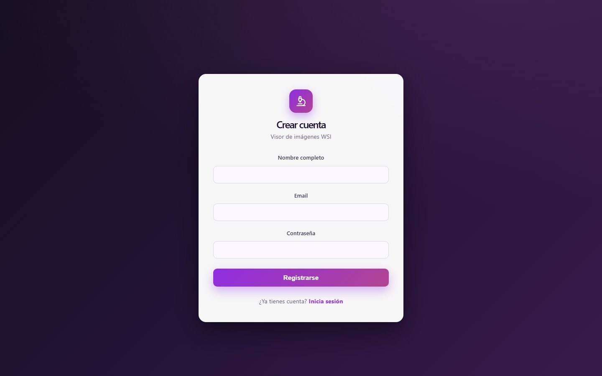

1. En la pantalla de inicio de sesión, pulsa **«Regístrate»**.
2. Escribe tu **nombre completo**, tu **email** y una **contraseña**.
3. Pulsa **«Registrarse»**. Entrarás directamente en la aplicación.

Si ya tienes cuenta, pulsa **«Inicia sesión»** para volver a la pantalla anterior.

---

## 3. Iniciar sesión

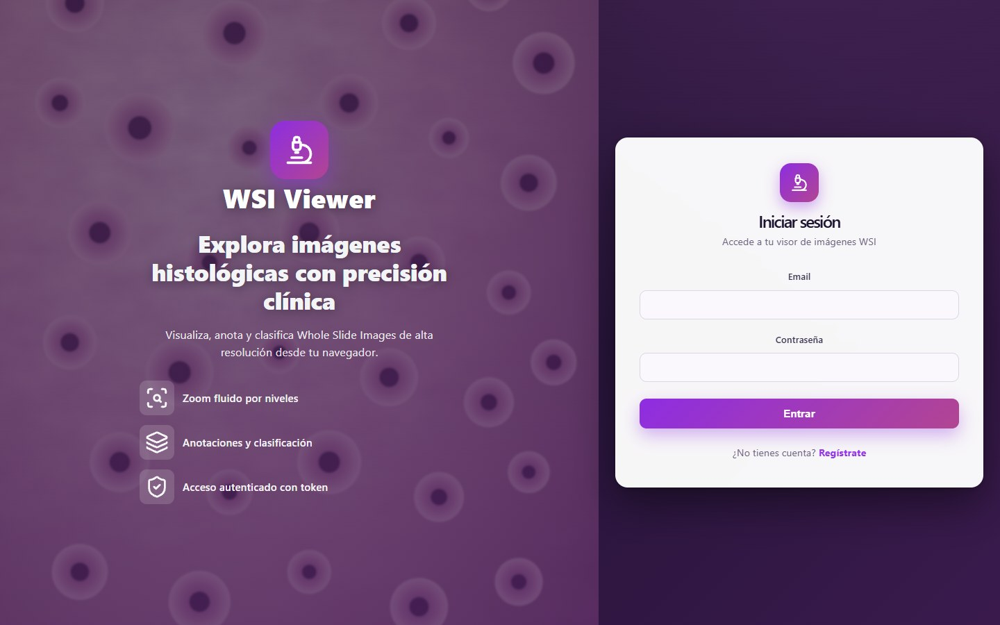

1. Escribe tu **email** y tu **contraseña**.
2. Pulsa **«Entrar»**.

Si los datos no son correctos, aparece un mensaje de error debajo del formulario.

---

## 4. Galería de imágenes

Es la pantalla principal: muestra todas las imágenes que has subido.

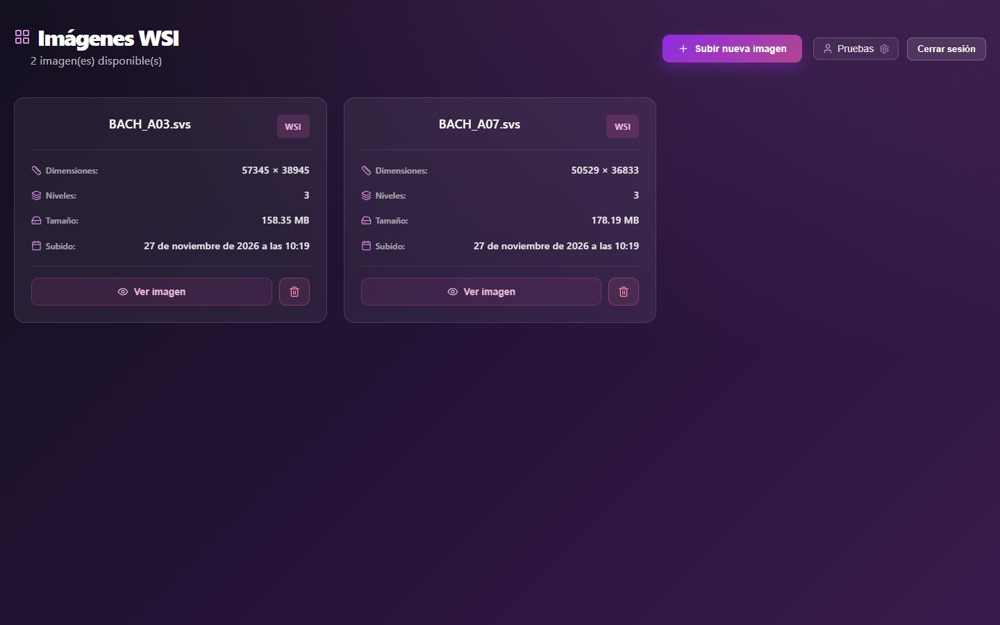

Cada tarjeta indica el **nombre** del archivo, sus **dimensiones** en píxeles, el
número de **niveles** de resolución, el **tamaño** y la **fecha de subida**.

| Para… | Haz esto |
|---|---|
| Abrir una imagen | Pulsa **«Ver imagen»** en su tarjeta |
| Subir imágenes nuevas | Pulsa **«Subir nueva imagen»** (arriba a la derecha) |
| Eliminar una imagen | Pulsa el icono de la **papelera** y confirma en el aviso **«¿Eliminar imagen?»**. Se borran también sus anotaciones y análisis, y no se puede deshacer |
| Ir a los ajustes de tu cuenta | Pulsa el botón con **tu nombre** |
| Salir | Pulsa **«Cerrar sesión»** |

---

## 5. Subir imágenes

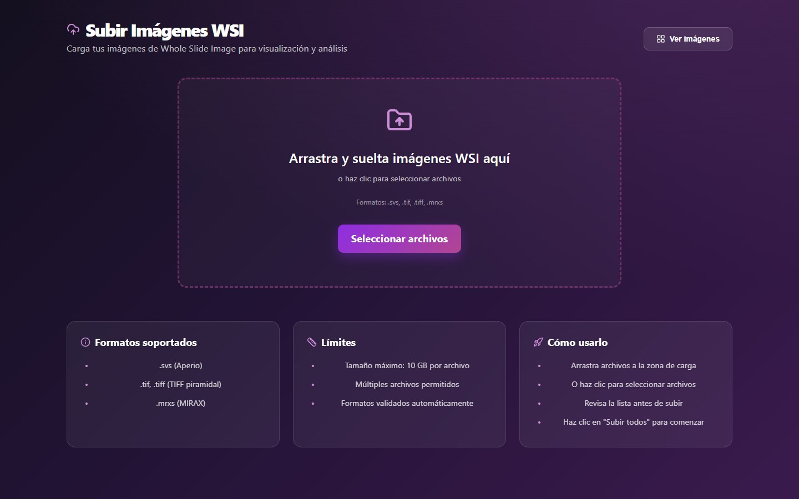

1. **Elige los archivos** de una de estas dos formas:
   - Arrástralos desde tu explorador de archivos a la zona punteada.
   - Pulsa **«Seleccionar archivos»** y elígelos (puedes marcar varios).
2. Revisa la lista **«Archivos»**. Si te has equivocado con alguno, quítalo con la
   **✕** roja de su fila.

   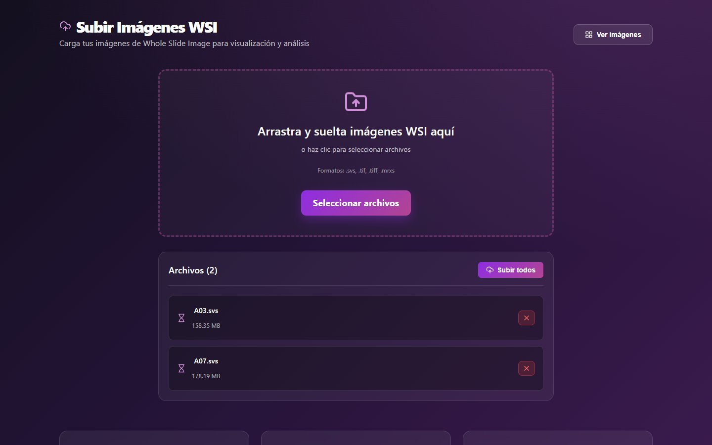

3. Pulsa **«Subir todos»**. Cada archivo indica su estado: pendiente, subiendo,
   subido correctamente o error (con el motivo).
4. Cuando termine, pulsa **«Ver imágenes»** para volver a la galería.

Ten en cuenta que:
- Los archivos con un formato no admitido o de más de 10 GB se marcan con un error
  en la lista y no se suben.
- No puedes tener dos imágenes **con el mismo nombre** en tu cuenta (sí puede
  tenerlas otro usuario). Si necesitas subir de nuevo una imagen, elimina antes la
  anterior o cambia el nombre del archivo.
- Las imágenes son muy grandes: la subida puede tardar varios minutos. No cierres
  la página mientras tanto.

---

## 6. Ajustes de la cuenta

Se abren pulsando **tu nombre** en la galería.

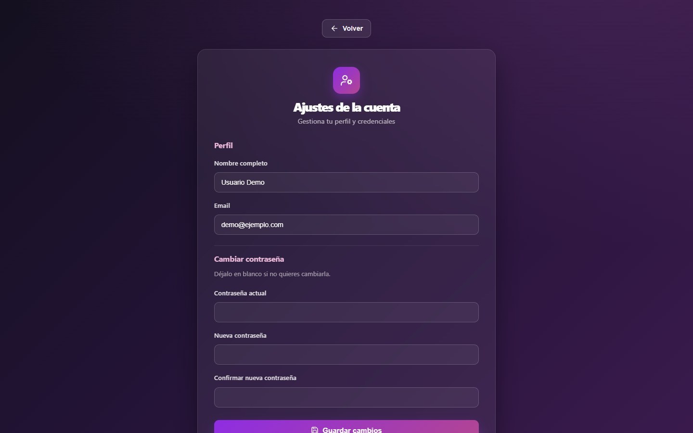

- **Perfil:** cambia tu **nombre completo** o tu **email** (el email no puede
  estar en uso por otra cuenta).
- **Cambiar contraseña:** escribe la **contraseña actual**, la **nueva** y su
  **confirmación**. Si no quieres cambiarla, deja estos campos vacíos.
- Pulsa **«Guardar cambios»** para aplicar los cambios, o **«Volver»** para salir
  sin guardar.

---

## 7. El visor de imágenes

Al pulsar «Ver imagen» se abre el visor, donde se explora la imagen a resolución
completa.

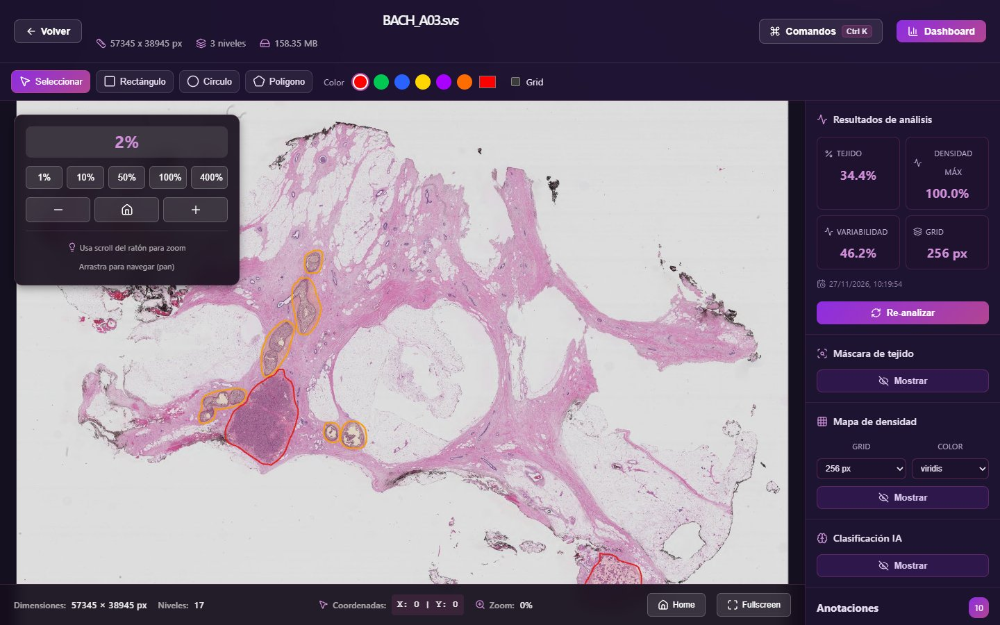

La pantalla tiene cuatro zonas:

| Zona | Contenido |
|---|---|
| **Cabecera** (arriba) | **«Volver»** a la galería, nombre y datos de la imagen (dimensiones, niveles, tamaño), botón **«Comandos»** y botón **«Dashboard»** |
| **Barra de herramientas** (debajo) | Herramientas de anotación, colores y rejilla ([sección 8](#8-anotar-regiones)) |
| **Imagen** (centro) | La imagen, con el control de zoom arriba a la izquierda y la barra de estado abajo |
| **Panel lateral** (derecha) | Resultados de análisis, máscara de tejido, mapa de densidad, clasificación IA y lista de anotaciones. Desplázalo hacia abajo para ver todo |

### Moverse por la imagen

- **Acercar o alejar:** usa la **rueda del ratón** sobre la imagen, o los botones
  **+** y **−** del control de zoom.
- **Desplazarse:** **arrastra** la imagen con el ratón (con la herramienta
  «Seleccionar» activa).
- **Zoom exacto:** pulsa **1 %**, **10 %**, **50 %**, **100 %** o **400 %** en el
  control de zoom. El 100 % muestra la imagen a su resolución máxima.
- **Volver a ver la imagen entera:** pulsa el icono de la **casa** en el control
  de zoom, o **«Home»** abajo a la derecha.
- **Pantalla completa:** pulsa **«Fullscreen»** abajo a la derecha (Esc para
  salir).
- La **barra de estado** (abajo) muestra las **coordenadas** del ratón en píxeles
  de la imagen y el **zoom** actual.

La imagen se carga por partes: al acercarte, las zonas se ven primero borrosas y
enseguida aparecen con todo detalle.

---

## 8. Anotar regiones

Las anotaciones marcan zonas de interés de la imagen y se guardan automáticamente.

### Dibujar

1. Elige el **color** en la barra de herramientas (o uno personalizado con el
   cuadro de color).
2. Elige la herramienta y dibuja sobre la imagen:

| Herramienta | Cómo se dibuja |
|---|---|
| **Rectángulo** | Pulsa en una esquina y arrastra hasta la esquina opuesta |
| **Círculo** | Pulsa en el centro y arrastra hacia fuera para dar el radio |
| **Polígono** | Haz clic en cada vértice; cierra la figura con **doble clic** o **Enter** (mínimo 3 vértices) |

   Pulsa **Esc** en cualquier momento para cancelar la figura y volver a
   «Seleccionar».

3. Al terminar la figura se abre la ventana **«Clasificar anotación»**:

   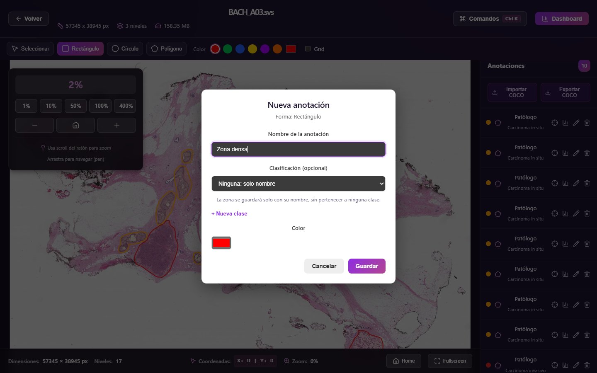

   - **Etiqueta:** un nombre libre (p. ej. «Zona densa»).
   - **Clasificación:** una de tus clases (p. ej. «Tumor»). Para crear una nueva,
     pulsa **«+ Nueva clase»** y elige nombre y color.
   - **Color** de la anotación.
   - Pulsa **«Guardar»**, o **«Cancelar»** para dejarla sin clasificar.

Para volver a mover la imagen con el ratón, selecciona de nuevo la herramienta
**«Seleccionar»**.

### Rejilla de referencia

Marca **«Grid»** en la barra de herramientas para superponer una rejilla sobre la
imagen. Puedes ajustar el **tamaño** de sus celdas (en píxeles de la imagen) y su
**opacidad**. Sirve como referencia visual; no afecta a los análisis.

### Lista de anotaciones

Al final del panel lateral aparecen todas las anotaciones de la imagen, con su
color, forma, etiqueta y clase.

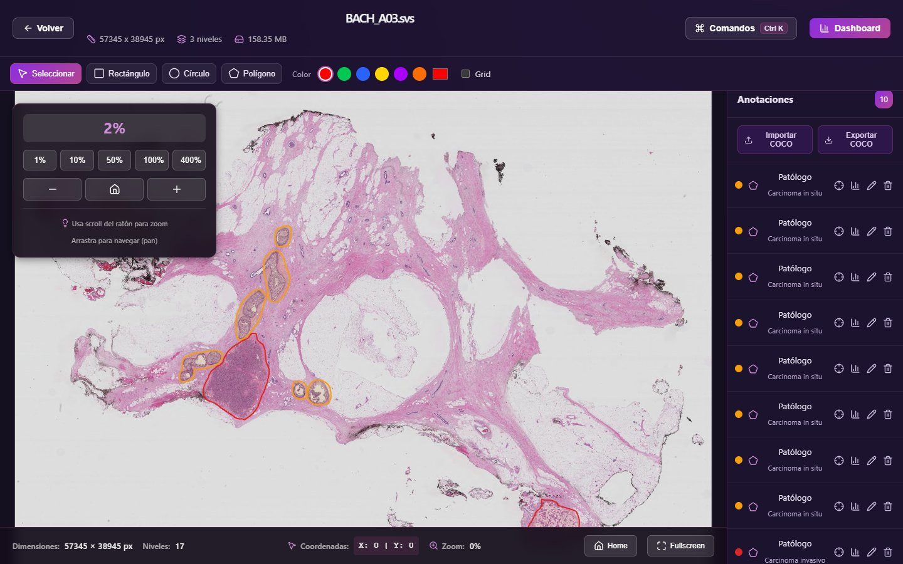

Cada anotación tiene cuatro botones:

| Icono | Acción |
|---|---|
| **Diana** (Centrar) | Mueve la vista para centrar la anotación |
| **Gráfico** (Analizar región) | Analiza solo esa zona y abre su dashboard ([sección 12](#12-analizar-solo-una-región)) |
| **Lápiz** (Editar) | Cambia su etiqueta, clase o color |
| **Papelera** (Eliminar) | Borra la anotación al momento (no pide confirmación) |

---

## 9. Análisis del tejido

Los análisis se manejan desde el **panel lateral**. La primera vez que se pide un
análisis tarda unos segundos; después se guarda y se muestra al instante.

### Resultados de análisis

El primer bloque del panel resume el análisis de la imagen: **% de tejido**,
**densidad máxima**, **variabilidad** de la densidad y **tamaño de celda** usado.
Pulsa **«Re-analizar»** para recalcularlo; mientras se calcula, verás una barra
de progreso que puedes cancelar.

### Máscara de tejido

Colorea en **verde** la parte de la imagen que es tejido y deja sin color el
cristal del portaobjetos.

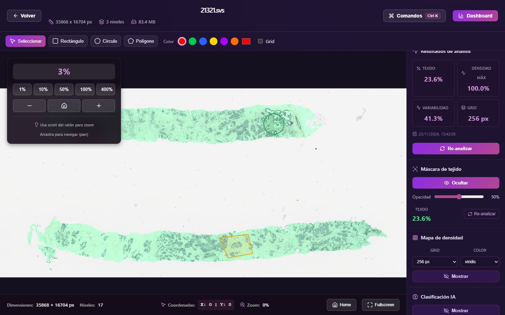

1. Pulsa **«Mostrar»** en el bloque «Máscara de tejido».
2. Ajusta la **opacidad** con el deslizador para ver mejor la imagen de debajo.
3. Pulsa **«Ocultar»** para quitarla.

El bloque indica el **% de la imagen** que es tejido. La detección reconoce
también el tejido muy pálido (grasa, estroma laxo) y descarta las marcas de
rotulador y los bordes del escáner.

### Mapa de densidad

Muestra **cómo de compacto** es el tejido: divide la imagen en celdas y colorea
cada una según la proporción de tejido que contiene.

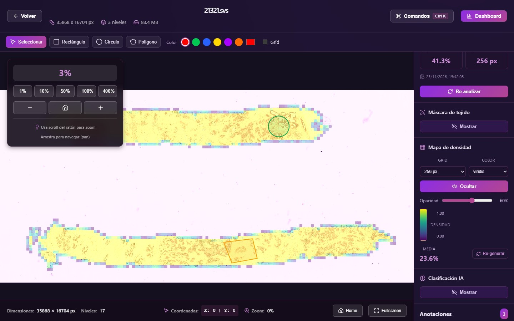

1. Elige el **tamaño de celda** (**Grid**): de 128 px (más detalle) a 1024 px (más
   general).
2. Elige la **escala de colores** (**Color**): viridis, hot, magma, plasma,
   inferno o jet.
3. Pulsa **«Mostrar»**. La leyenda de colores indica la densidad, de 0 (sin
   tejido) a 1 (celda llena de tejido).
4. Pasa el ratón por la imagen para ver la densidad de cada celda.

Al cambiar el tamaño de celda o la escala de colores con el mapa visible, se
actualiza automáticamente. **«Re-generar»** lo recalcula.

---

## 10. Clasificación con inteligencia artificial

Un modelo de IA (InceptionV3, entrenado con tejido mamario) clasifica el tejido en
cuatro clases:

| Color | Clase |
|---|---|
| Verde | **Normal** |
| Azul | **Benigno** |
| Ámbar | **Carcinoma in situ** |
| Rojo | **Carcinoma invasivo** |

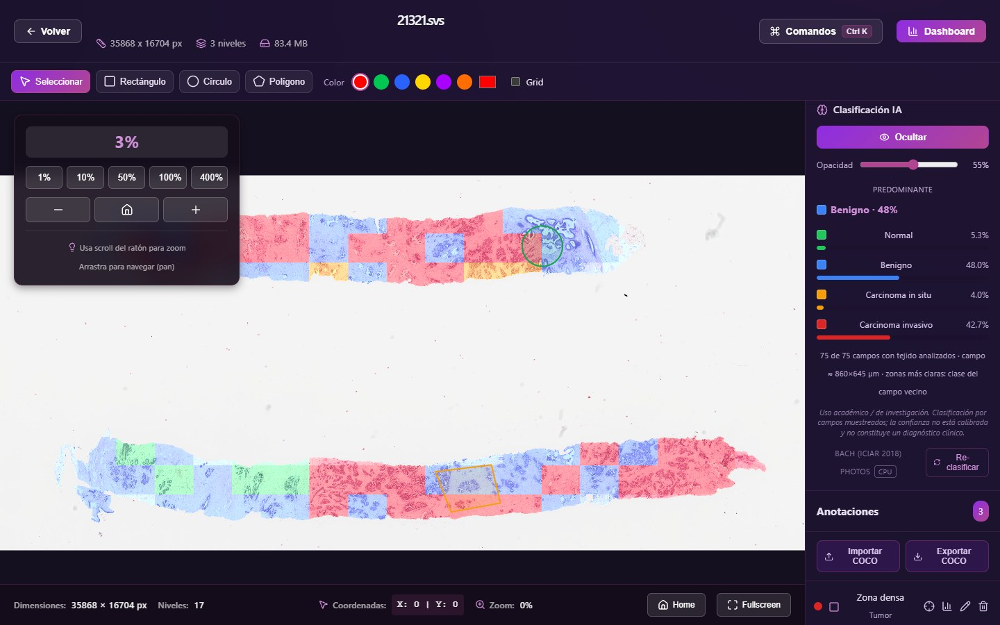

1. Pulsa **«Mostrar»** en el bloque «Clasificación IA». La primera vez tarda unos
   segundos (más en imágenes grandes).
2. Sobre la imagen aparece el **mapa de clases**, que sigue el contorno del
   tejido. Ajusta su **opacidad** con el deslizador.
3. En el panel verás:
   - La clase **predominante** y el porcentaje de cada clase.
   - Cuántas zonas se han analizado (p. ej. «75 de 75 campos con tejido
     analizados»). Cada zona o **campo** mide unos 0,86 × 0,65 mm.
   - Si la IA se ha ejecutado en **CPU** o **GPU** (junto al nombre del modelo).
4. **«Re-clasificar»** repite el análisis.

Cómo interpretar el mapa:
- Cada **rectángulo de color** es un campo que el modelo ha analizado.
- Las zonas **más claras** (normalmente en los bordes del tejido) no se han
  analizado directamente: toman la clase del campo vecino y **no cuentan** en los
  porcentajes.
- Los porcentajes son **de campos analizados**, no de superficie exacta.

---

## 11. Dashboard de análisis

Pulsa **«Dashboard»** en la cabecera del visor para ver un resumen de todos los
análisis de la imagen.

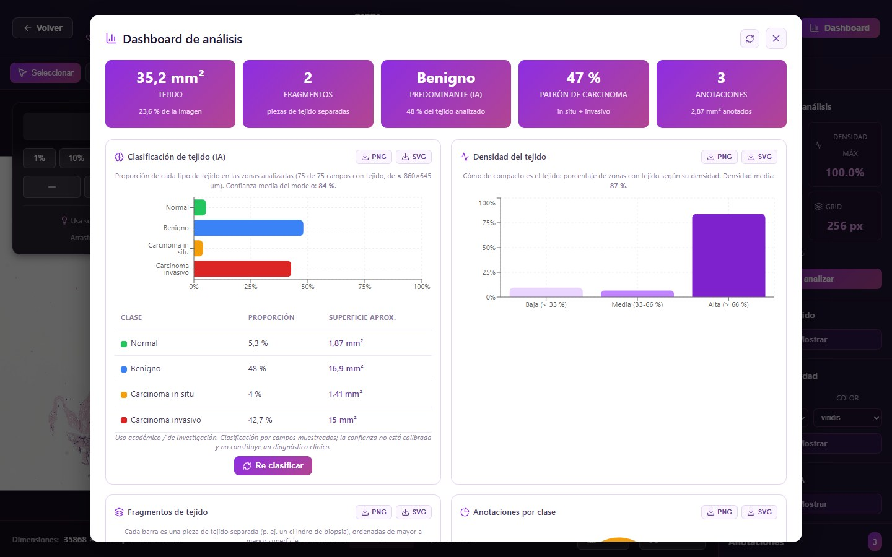

**Resumen** (fila superior):
- **Tejido:** superficie de tejido en mm² y % de la imagen.
- **Fragmentos:** número de piezas de tejido separadas (p. ej. cilindros de
  biopsia).
- **Predominante (IA):** clase más frecuente.
- **Patrón de carcinoma:** % de tejido clasificado como in situ o invasivo.
- **Anotaciones:** cuántas hay y qué superficie ocupan.

**Bloques:**
- **Clasificación de tejido (IA):** proporción de cada clase, superficie
  aproximada y confianza media del modelo. Si la imagen aún no se ha clasificado,
  aparece el botón **«Ejecutar clasificación IA»**.
- **Densidad del tejido:** qué parte de las zonas con tejido tiene densidad baja,
  media o alta. Necesita haber generado antes el mapa de densidad.
- **Fragmentos de tejido**, **Anotaciones por clase** e **Información de la
  imagen** (tamaño real en mm, resolución y aumento):

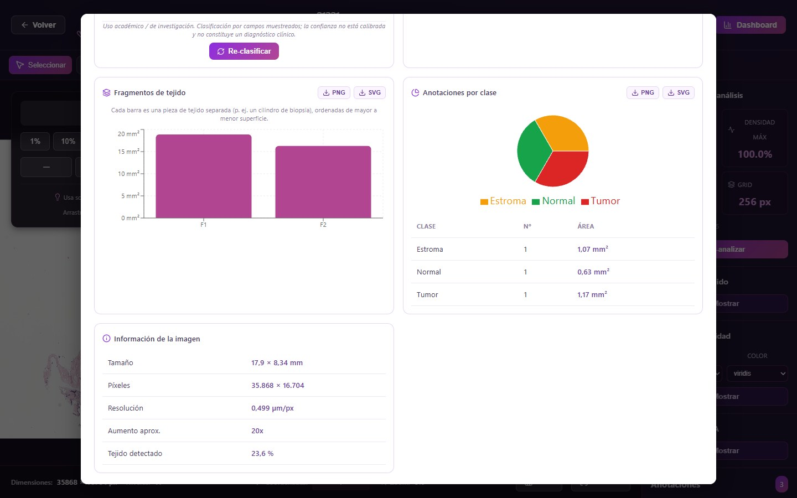

Cada gráfica se puede **descargar** como imagen con los botones **PNG** o **SVG**.
El botón de **flechas** (arriba a la derecha) actualiza los datos y la **✕**
cierra el dashboard.

---

## 12. Analizar solo una región

Puedes repetir todos los análisis **solo dentro de una anotación**, como si fuera
una imagen independiente:

1. En la lista de anotaciones, pulsa el icono de **gráfico** (Analizar región).
2. Se calcula el análisis de esa zona y se abre su **dashboard**, con los mismos
   bloques que el de la imagen completa.

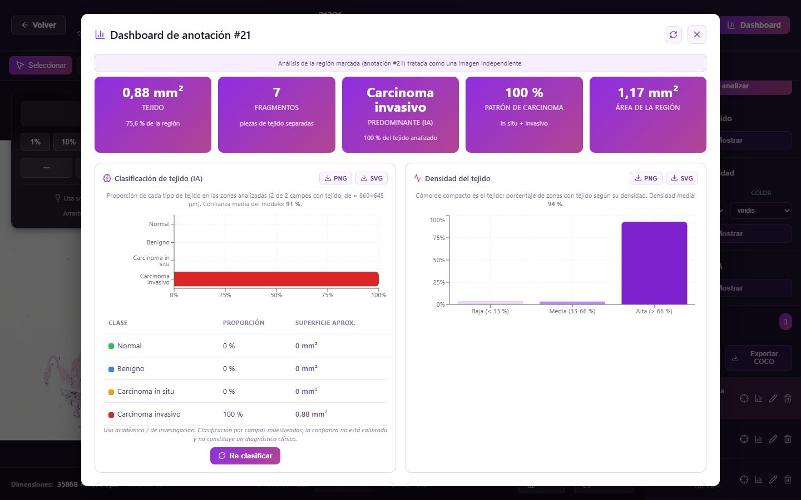

En círculos y polígonos solo se tiene en cuenta lo que queda **dentro** de la
forma. Si la región es más pequeña que un campo de la IA (unos 0,86 × 0,65 mm), el
modelo ve también algo del tejido de alrededor.

---

## 13. Importar y exportar anotaciones (COCO)

COCO es un formato estándar de anotaciones que entienden muchas herramientas de
análisis de imagen.

- **Exportar:** pulsa **«Exportar COCO»** en el bloque «Anotaciones». Se descarga
  el archivo `<nombre de la imagen>_coco.json` con todas sus anotaciones.
- **Importar:**
  1. Pulsa **«Importar COCO»**.
  2. Pulsa **«Seleccionar archivo COCO (.json)»** y elige el archivo.
  3. Pulsa **«Importar»**. Las anotaciones se añaden a la imagen, y las clases que
     no existían se crean automáticamente.

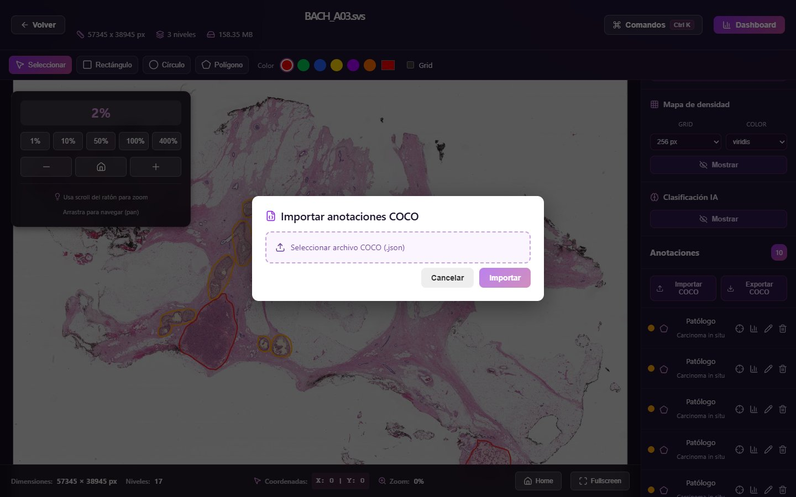

Exportar e importar en esta aplicación conserva la forma exacta (rectángulo,
círculo o polígono), la etiqueta y el color de cada anotación.

---

## 14. Paleta de comandos

Reúne todas las acciones del visor en un buscador. Ábrela con **Ctrl + K** (en Mac,
**Cmd + K**) o con el botón **«Comandos»** de la cabecera.

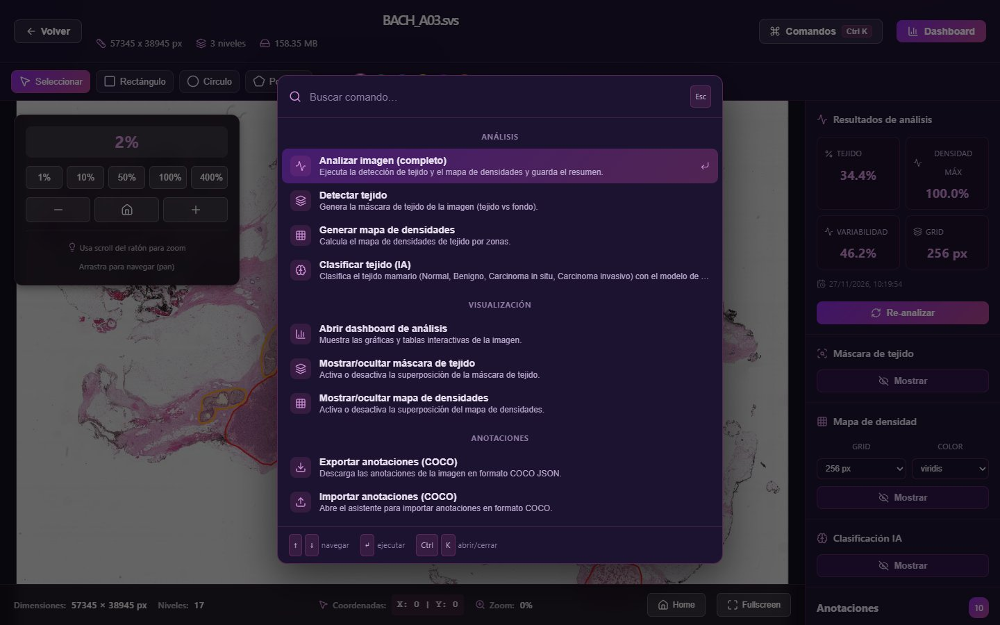

1. Escribe parte del nombre de la acción (p. ej. «IA», «tejido», «COCO»).
2. Muévete con las flechas **↑ ↓** y pulsa **Enter** para ejecutarla, o haz clic
   sobre ella.
3. **Esc** cierra la paleta.

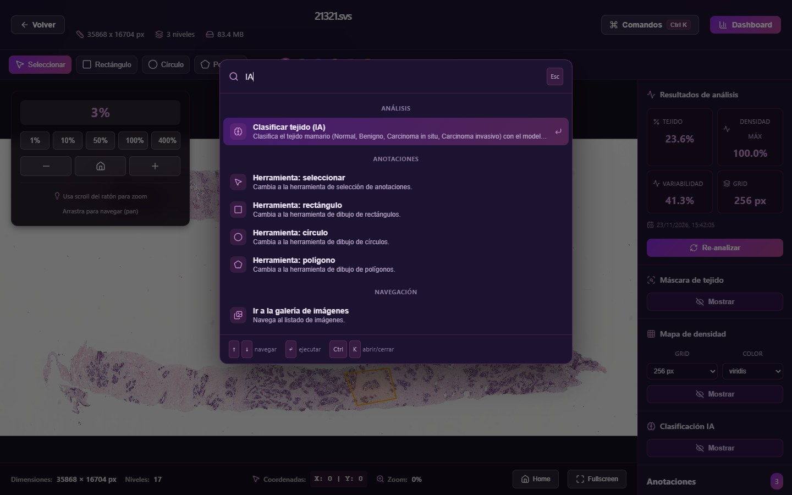

| Grupo | Acciones |
|---|---|
| **Análisis** | Análisis completo, detectar tejido, generar mapa de densidad, clasificar tejido (IA) |
| **Visualización** | Abrir el dashboard, mostrar u ocultar la máscara de tejido y el mapa de densidad |
| **Anotaciones** | Exportar o importar COCO, elegir herramienta (seleccionar, rectángulo, círculo, polígono) |
| **Navegación** | Ir a la galería, ir a la pantalla de subida |

---

## 15. Problemas frecuentes

| Problema | Causa y solución |
|---|---|
| «Archivo … ya existe» al subir | Ya tienes en tu cuenta una imagen con ese nombre. Elimínala o renombra el archivo |
| «Tipo de archivo no válido» | Solo se admiten `.svs`, `.tif`, `.tiff` y `.mrxs` |
| Un archivo se rechaza tras subirlo | El archivo no es una WSI válida o está dañado |
| La clasificación IA muestra un error del modelo no disponible | Faltan los pesos del modelo en el servidor. Avisa al administrador; el resto de la aplicación funciona con normalidad |
| La aplicación te devuelve a la pantalla de inicio de sesión | La sesión ha caducado (24 h). Vuelve a iniciar sesión |
| El primer análisis de una imagen tarda | Es normal: se calcula una vez y queda guardado. La IA tarda más en imágenes grandes, sobre todo en CPU |
| El dashboard no muestra la densidad | Genera antes el mapa de densidad desde el panel lateral (o con «Re-analizar») |
| Un análisis antiguo cambia al abrirlo | Si la aplicación se actualiza con un algoritmo o modelo nuevo, los resultados antiguos se recalculan solos |

---

## 16. Glosario

- **WSI (Whole Slide Image):** digitalización completa de un portaobjetos, con
  decenas de miles de píxeles por lado.
- **Anotación:** zona de la imagen marcada a mano (rectángulo, círculo o
  polígono), con etiqueta y clase opcionales.
- **Clase:** categoría que asignas a tus anotaciones (p. ej. «Tumor»). Tú decides
  sus nombres y colores.
- **Máscara de tejido:** capa que separa el tejido del cristal del portaobjetos.
- **Densidad:** proporción de tejido dentro de una celda (0 = vacía, 1 = llena).
- **Campo:** cada zona de unos 0,86 × 0,65 mm que analiza la IA.
- **Opacidad:** transparencia de una capa sobre la imagen.
- **COCO:** formato estándar de archivos de anotaciones.
- **CPU / GPU:** procesador del equipo o tarjeta gráfica; la IA es más rápida en
  GPU.
